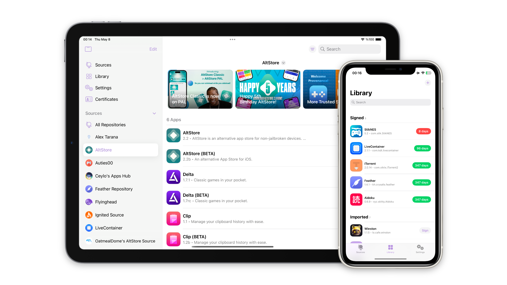

# RyukSign

[](https://github.com/faroukbmiled/RyukSign/releases)
[](https://github.com/faroukbmiled/RyukSign/releases)
[](https://github.com/faroukbmiled/RyukSign/blob/main/LICENSE)

RyukSign signs and installs iOS apps on device using your own certificate. It is a fork of [Feather](https://github.com/claration/Feather) by [claration](https://github.com/claration), with a Tweak Manager, a file transfer server, a better download manager and curated repositories added on top. Upstream attribution is kept, see [Acknowledgements](#acknowledgements).

<p align="center"><picture><source media="(prefers-color-scheme: dark)" srcset=".github/images/Image-dark.png"><source media="(prefers-color-scheme: light)" srcset=".github/images/Image-light.png"></picture></p>

## Features

From Feather:

- Sign and install apps with a `.p12` and `.mobileprovision` pair (Zsign)
- [AltStore](https://faq.altstore.io/distribute-your-apps/make-a-source#apps) repository support
- Detailed app and certificate info
- Signing options for appearance, Files app support, compatibility patching and Liquid Glass
- No tracking or analytics

Added in RyukSign:

- **Tweak Manager:** import, organize and inject `.dylib`, `.deb`, `.framework`, `.bundle` and `.appex` files, with per file settings and a dependency inspector
- **Downloads:** background downloads with Live Activities, Dynamic Island and an in-app overlay
- **File Transfer:** upload IPAs and tweaks from a browser or mount over WebDAV, with optional password
- **Updates:** see which Library apps have a newer version in your sources, pick or pin the source, or ignore an app
- **Sources:** offline copies that open instantly, favorites, sorting and combined news
- Curated repositories and a configurable tab bar

## How it works

Apps are signed on device with Zsign using your certificate pair, then installed one of two ways.

**Local server.** RyukSign hosts the IPA on a local HTTPS server (certificates from [backloop.dev](https://backloop.dev/)) and opens `itms-services://?action=download-manifest&url=<PLIST_URL>`. On iOS 18 this needs the `Associated Domains`, `Custom Network Protocol`, `MDM Managed Associated Domains` and `Network Extensions` entitlements. Without them, the manifest can be served by an external server such as [plistserver](https://github.com/nekohaxx/plistserver) while the IPA stays local.

**Pairing.** With a [pairing file](https://github.com/jkcoxson/idevice_pair) and a VPN, RyukSign connects to `10.7.0.1` over AFC, uploads the IPA to `/PublicStaging/` and installs it directly, like `ideviceinstaller` but on device. A computer is needed once to create the pairing file.

## Download

Get the latest `.ipa` from [Releases](https://github.com/faroukbmiled/RyukSign/releases).

## Building

Requires Xcode 27. See [CONTRIBUTING.md](.github/CONTRIBUTING.md) for details.

```bash
git clone --recursive https://github.com/faroukbmiled/RyukSign.git
cd RyukSign
make deps
open RyukSign.xcworkspace
```

`make deps` fetches the SSL pack for the local install server. Set your own team in Xcode to sign.

## Contributing

Read the [contribution guide](.github/CONTRIBUTING.md).

## Acknowledgements

- [claration](https://github.com/claration), author of [Feather](https://github.com/claration/Feather)
- [idevice](https://github.com/jkcoxson/idevice), used to talk to `installd`
- [backloop.dev](https://backloop.dev/), localhost with a public SSL certificate
- [Vapor](https://github.com/vapor/vapor), HTTP server
- [Zsign](https://github.com/zhlynn/zsign), on-device signing
- [ElleKit](https://github.com/tealbathingsuit/ellekit), tweak injection
- [LiveContainer](https://github.com/LiveContainer/LiveContainer), fixes and help
- [Nuke](https://github.com/kean/Nuke), image caching
- [Asspp](https://github.com/Lakr233/Asspp), HTTP server reference
- [plistserver](https://github.com/nekohaxx/plistserver), hosted at https://api.palera.in

## License

[GPL-3.0](./LICENSE), the same license as Feather. The full source for every release is this repository. Contributions are licensed under GPL-3.0.

## Disclaimer

RyukSign is only distributed on this GitHub page. Copies hosted elsewhere may be malicious.
